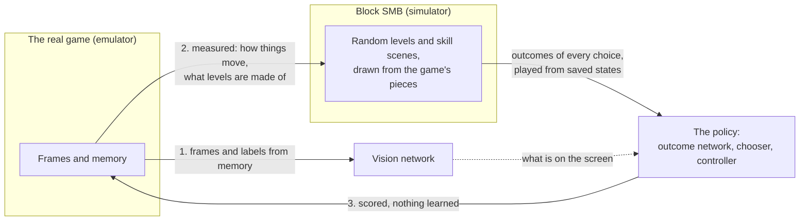
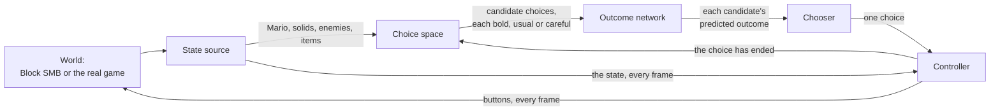
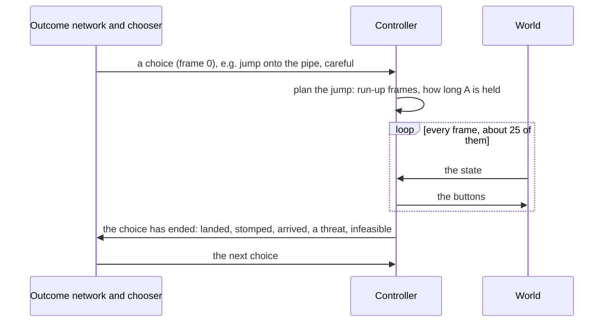
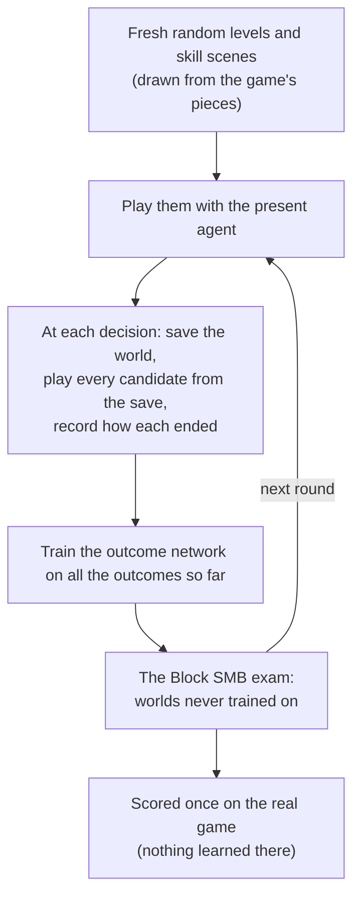

# RetroAGI

A Super Mario Bros agent that learns to play in a fast, cheap stand-in for
the game. It meets the real game only after it has been trained, and it
plays the real game from the screen's picture alone. The game stands in for
a robot's real situation, where nothing can be trained by trial and error.

The project is a game-neutral framework (`retroagi/framework`) with Super
Mario Bros as its first domain (`retroagi/domains/smb`). It is built from
an adaptive controller and interchangeable models, composed through
declared interfaces ([the framework](docs/framework.md)).

**What the project must be** is in
[docs/requirements.md](docs/requirements.md), in the project owner's words.
That page is the authority: where any other document or the code disagrees
with it, they are wrong and are corrected.

## The real game and Block SMB

Block SMB is a simulator that copies how the game behaves: Mario's motion,
each enemy's rules, the pieces levels are made of and their sizes. It is
drawn as plain blocks and loads none of the game's pictures, levels or
program. Everything that decides and controls learns there.



The real game is used for three things only:

1. **To train seeing.** The vision network learns from the game's frames,
   labelled from its memory.
2. **To measure how the game behaves**, so that Block SMB behaves the same.
   Things are read from the game's memory while Mario is flown through a
   level or held still beside an enemy.
3. **To score the finished agent.** Nothing learns while it plays, and a
   failure there is only ever turned into the question "what does Block
   SMB lack?".

No model learns a real level's layout. Every practice world is drawn at
random from the game's pieces. The levels scored on (Worlds 1-1, 4-1, 6-1,
7-1 and 8-1) are not even read for building Block SMB.

## The design: choose and control

The agent has five parts, each behind an interface in
`retroagi/framework/interfaces.py`, so any one can be exchanged for
another that answers the same question.



| Part | What it reads | What it gives |
|---|---|---|
| **State source** | the world | where Mario, the solids, the enemies and the items are. In Block SMB a lookup in the simulator; in the real game from the vision network (`domains/smb/perception/`) |
| **Choice space** (`domains/smb/choices.py`) | the state | what can be done now: jump onto a thing, stomp or pass an enemy, run to a place, wait, bump a block, collect an item. Each comes in three ways of being carried out (bold, usual, careful: how wide a berth enemies get, how long a landing must stay clear of them, how soon a coming enemy ends a run) |
| **Outcome network** (`framework/outcome_network.py`) | the state and every candidate | in one pass, for every candidate: the chance of dying, of being infeasible, of getting stuck, of reaching the flag; the progress, frames and points |
| **Chooser** (`framework/chooser.py`) | the predictions | one choice, by the game's fixed priorities: don't die, progress to the right, get coins and power-ups |
| **Controller** (`domains/smb/controller.py`, `planner.py`) | the choice, and the state every frame | the buttons each frame. It plans the jump (run-up, how long the button is held) with Mario's motion as the game computes it, plans again before takeoff, corrects in the air, and says how the choice ended |

The deep model is consulted seldom; the controller runs every frame
between decisions, with no network inside it:



| Measured on one processor core | Time |
|---|---|
| The controller, each frame | 0.03 to 0.05 ms |
| The controller, planning a jump | 0.7 to 1.0 ms, once a choice |
| The outcome network, one decision | 1.4 ms (2.3 on the GPU), once a choice |
| Vision in the real game, each frame | 4 ms |
| Block SMB, a step and a state lookup | 0.09 ms |

The whole agent plays Block SMB 70 to 105 times faster than the game's 60
frames a second, so training data is cheap.

## How the outcome network learns

It learns from outcomes measured, not from a teacher. At states the agent
reaches in Block SMB, every candidate choice is played out from a saved
copy of the world by the controller, and what happened is recorded.



A skill scene is a short world that calls for one skill (a gap, a
springboard, a fire bar, a Hammer Bro); a random level strings the game's
pieces together at the spacings measured in the game.

## What Block SMB has of the game

Each thing was measured in the game's memory, in levels not scored on:

- Goombas, green and red Koopa Troopas and their shells, Buzzy Beetles,
  hopping and flying Paratroopas, piranha plants;
- Hammer Bros, Lakitu and his Spinies, Bullet Bills and their cannons,
  Bullet Bill and Cheep Cheep frenzies;
- question blocks, bricks, mushrooms and big Mario;
- lifts across, up and down and falling, springboards;
- castle fire bars and lava fireballs, Bowser on his bridge, his flames and his hammers;
- pipes, staircases, pits, bridges, and the sky levels' ledges.

Still missing: looping and balance lifts, water levels, and blocks invisible until hit.
[How general is it?](docs/generalization.md) has every measurement.

## Where it stands (2026-11-13)

Learned from nothing in Block SMB in one run (`scripts/learn_in_block_smb.sh`),
then scored on the real game from the screen alone:

| | Without the care variants | With them |
|---|---|---|
| World 1-1, whole plays finished | 4 of 8 | 7 of 8 |
| Held-out real levels (4-1, 6-1, 7-1, 8-1): tries at an obstacle that fail | 36% | 38% |
| Held-out real levels finished | 2 of 32 | 1 of 32 |
| Fresh Block SMB levels finished | 159 of 200 | 152 of 200 |

A working agent needs about 2% of tries to fail: a level has about 35
obstacles. The gap is what Block SMB still lacks of the game, which is
closed by measuring more of it, and what vision's errors cost, which is
seeing's own work. Neither network has yet learned in the Block SMB
widened since (springboards, fire bars, lava, lifts, Lakitu and more).

## Usage

The [reproducibility procedure](docs/reproducibility.md) goes from a clean
checkout to a trained and scored agent. The main commands:

```bash
# learn the deciding network from nothing in Block SMB, round after round (hours)
scripts/learn_in_block_smb.sh NAME
# play fresh random Block SMB levels with a network choosing
python -m retroagi.framework.practice --domain smb --levels 100 --first-seed 100000 --model data/outcome/outcome_care_20261112.pt
# score it on each obstacle of a real level, from the screen
python -m retroagi.framework.bench --domain smb --bench data/full_smb_obstacles/Level1-1 --source vision --model data/outcome/outcome_care_20261112.pt
# play a whole real level from its start
python -m retroagi.framework.play --domain smb --level Level1-1 --source vision --model data/outcome/outcome_care_20261112.pt
# run the tests
python -m pytest scripts/tests
```

Other tools:

- `python scripts/mario_scenario_env.py` plays Block SMB by keyboard.
- `python scripts/dev/game_catalogue.py` and `scripts/dev/measure_enemy.py`
  read what the game holds and how each thing moves.
- `python scripts/smb_physics_audit.py --output <file>` checks that Block
  SMB moves Mario exactly as the emulator does.

## Project layout

```text
retroagi/
  framework/                     # game-neutral: imports no domain
    interfaces.py                # what a domain supplies; what the parts ask of each other
    agent.py                     # the loop: state, chooser, controller, one action a frame
    outcome_network.py           # predicts every choice's outcome in one pass
    chooser.py                   # the fixed priorities on those predictions
    observed_dynamics.py         # a dynamics model fitted to what is seen of each thing
    registry.py                  # domains by name; their parts' alternatives (--use PART=NAME)
    sampling.py, training.py     # outcomes measured in practice worlds; the network trained on them
    practice.py, bench.py, play.py   # practice worlds, obstacle benches, whole levels
  domains/smb/                   # Super Mario Bros
    domain.py                    # the game as the framework sees it
    controller.py, planner.py    # one choice at a time, every frame; the jump planner (compiled)
    physics.py                   # Mario's motion, as the game computes it
    choices.py                   # the candidate choices and the state as numbers
    scripted_chooser.py          # a hand-written chooser, the yardstick
    perception/                  # the vision network, tracking, vision to state
    sim/                         # Block SMB: the simulator, random levels and skill scenes
    nes/                         # the real game: emulator, game memory, obstacle benches
  legacy/                        # retired code, kept running; nothing above imports it
scripts/
  vit/, vision/                  # train and measure the vision networks
  dev/                           # measuring the game, the scorecard, result tables
  tests/                         # the test suite
```

## Supported platforms

Linux x86-64 and macOS Apple Silicon, Python 3.12 to 3.14, PyTorch 2.9.1
with torchvision 0.24.1. It runs on the processor alone; CUDA and Apple
Metal are used when present. The reference runs used an Intel NUC (12th
generation, 64 GB) with an NVIDIA Tesla V100 (32 GB) in an external
enclosure over Thunderbolt.

See the [compatibility matrix](docs/compatibility.md) before creating an
environment. The real game needs the ROM imported into stable-retro:
[docs/full-smb-content.md](docs/full-smb-content.md).
